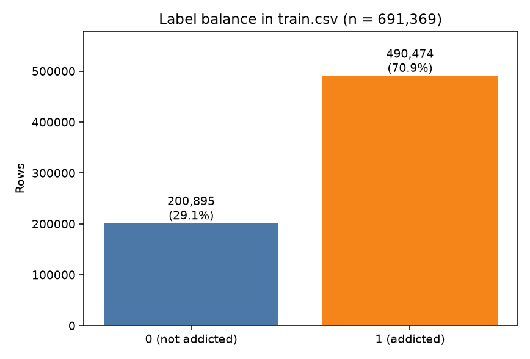
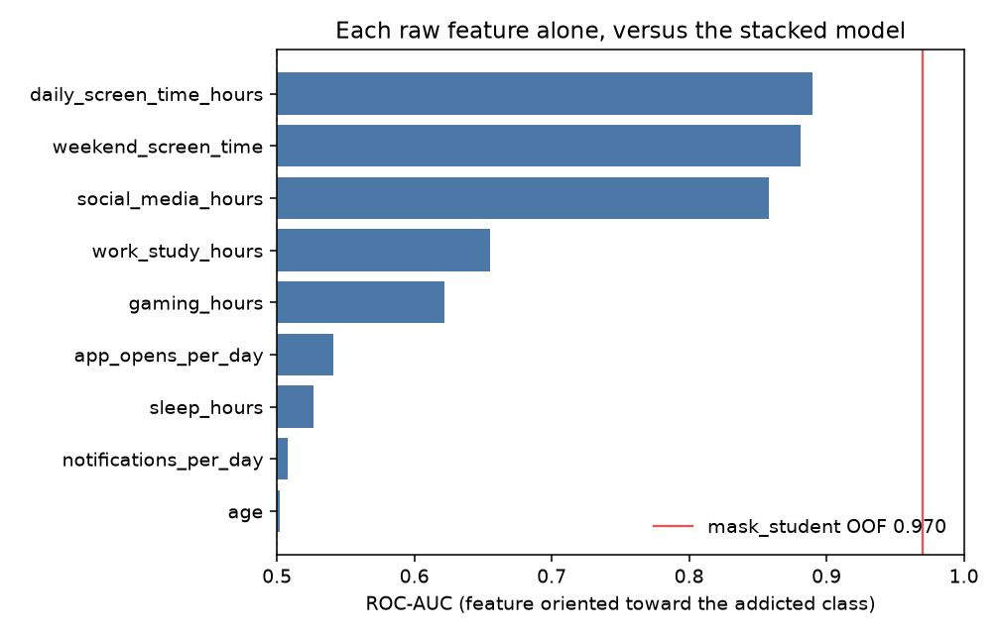
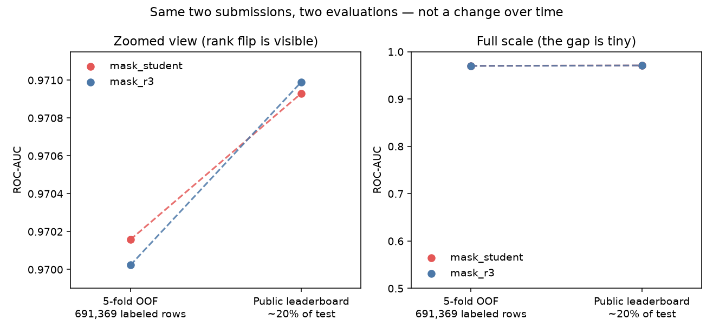

# Predicting Smartphone Addiction

Can everyday phone-use features predict a binary `addicted_label`, and is a tiny public-leaderboard gap a safe way to pick the final model?

## Dataset

Source: [Kaggle Playground Series S6E8 — Predicting Smartphone Addiction](https://www.kaggle.com/competitions/playground-series-s6e8).

The training table has 691,369 rows and the columns `age`, `daily_screen_time_hours`, `social_media_hours`, `gaming_hours`, `work_study_hours`, `sleep_hours`, `notifications_per_day`, `app_opens_per_day`, `weekend_screen_time`, `gender`, `stress_level`, `academic_work_impact`, and `addicted_label`.

Usage permission: the files are distributed under the Kaggle competition rules. This repository does not include `train.csv` or `test.csv`. Download them from the competition data page after joining the competition, and do not commit them here.

## Methods and tools

Python, pandas, matplotlib, and scikit-learn.

This repository recomputes two views of the training table:

- the class balance of `addicted_label`
- the ROC-AUC of each numeric feature on its own, using rows where that feature is observed, with the score flipped when the raw direction is below 0.5

The completed model is a five-fold stacked logistic regression (`mask_student`) trained on out-of-fold predictions rather than on the raw columns. That experiment, including the notebook that writes `submission.csv`, is in [DeoxysD/Kaggle](https://github.com/DeoxysD/Kaggle/tree/main/Predicting%20Smartphone%20Addiction). Its recorded scores are replotted here. They are not recomputed by `analysis.py`.

## Key findings and one limitation

About 70.9% of training rows are labeled addicted (490,474 of 691,369), so accuracy would look strong for a constant “addicted” prediction. ROC-AUC is the metric used for that reason.

Screen-time features already separate the classes: `daily_screen_time_hours` reaches about 0.890 AUC on its observed rows, `weekend_screen_time` about 0.881, and `social_media_hours` about 0.858. Age and notification counts stay near 0.50. The stacked `mask_student` model reaches **0.970158** OOF AUC, above the best raw feature and 0.000135 above the previous stack `mask_r3` (0.970023).

On the public leaderboard (about 20% of the test set) the order flips: `mask_r3` 0.97099, `mask_student` 0.97093. The private leaderboard later agreed with the OOF ranking. The right-hand panel of the comparison chart keeps the axis on 0.5–1.0 so the 0.00006 public gap is not mistaken for a large change.

Limitation: several raw features are missing for tens of thousands of rows, so the single-feature AUCs are not computed on identical samples. The public-leaderboard gap is also smaller than the leaderboard’s displayed precision can really resolve.







## How to run

Python 3.12. The versions pinned in `requirements.txt` match the environment used to draw these figures (conda env `mew`).

```bash
pip install -r requirements.txt
# train.csv stays outside the repo
export DATA_DIR=/path/to/folder
python analysis.py
```

`analysis.py` writes:

- `figures/01_label_balance.png`
- `figures/02_oof_vs_public_rank.png`
- `figures/03_single_feature_auc.png`

If `train.csv` is missing, the script stops with the download instruction instead of failing on a missing path later. Open `analysis.ipynb` and run all cells for the same result.
